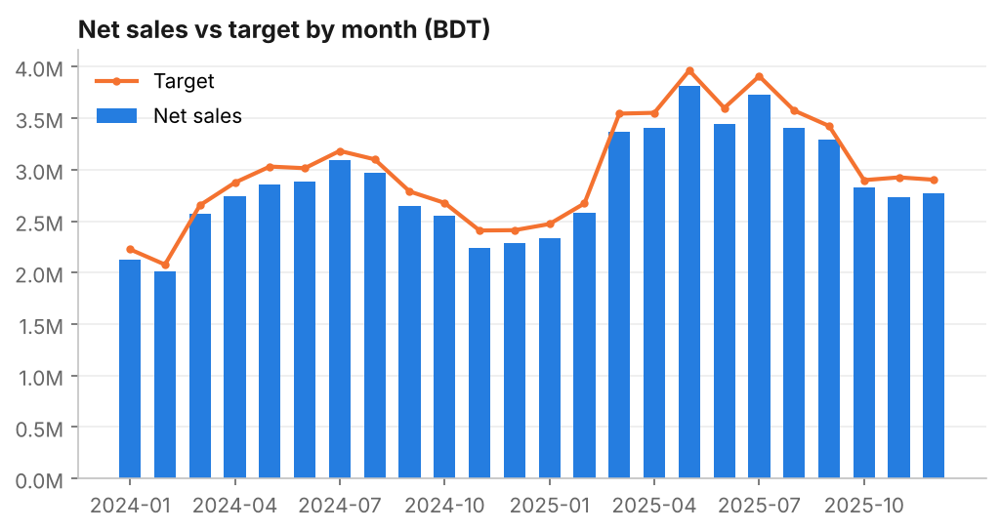
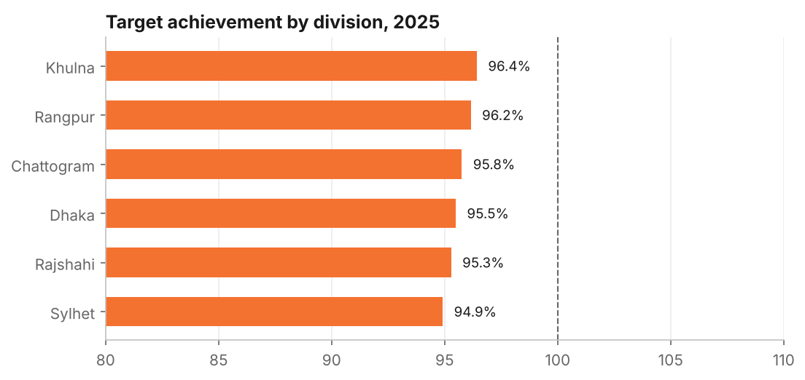

# FMCG Sales & Distribution Analytics (Power BI)

[](https://github.com/mprantikk/fmcg-sales-powerbi/actions/workflows/ci.yml)


A Power BI sales and distribution model for a fictional dairy and beverage company selling through 22 distributors to 1,164 retail outlets across Bangladesh. It covers what an FMCG sales team reviews every week: sales vs target by territory, field-force productivity, outlet coverage, SKU mix, and whether the sales-app data can be trusted.

It is based on the kind of work I did as a BI Executive in FMCG: territory and distributor reporting, sales-officer targets, and a field sales app whose data had to be cleaned before anyone could use it. All data here is synthetic.



> The charts above are Python previews of the report views. Power BI report screenshots: *coming soon* (`docs/page-*.png`).

## What's in the model

| | |
|---|---|
| **Star schema** | 3 fact tables at different grains (invoice line, outlet visit, rep × month target) sharing date, product, outlet, rep and territory dimensions. See [MODEL.md](powerbi/MODEL.md) |
| **30+ DAX measures** | Net sales after returns, YoY, MTD/YTD, target achievement and status, strike rate, drop size, lines per call, numeric distribution, SKU share, territory rank, outlet Pareto. See [measures.dax](powerbi/measures.dax) |
| **Reconciliation targets** | Every headline number computed independently in pandas, so the Power BI cards can be checked. See [EXPECTED_KPIS.md](powerbi/EXPECTED_KPIS.md) |
| **Sales-app data quality** | 7 validation rules on the raw field-app export (offline re-sync duplicates, unknown outlet codes, fat-finger quantities, wrong device clocks, missing check-ins, stale prices) before data reaches the model |
| **Ready-made Power BI project** | `powerbi/pbip/FMCG Sales.pbip`: the full semantic model as TMDL (tables, relationships, date table, hierarchy, measures), generated by `scripts/build_pbip.py` |
| **Report design** | 5 pages (Executive, Territory, Field force, Product & distribution, Data quality), a custom theme, and a build guide. See [BUILD_GUIDE.md](powerbi/BUILD_GUIDE.md) |

## Headline numbers (2025)

| KPI | Value |
|---|---:|
| Net sales | BDT 37.7M (+21.7% YoY) |
| Target achievement | 95.6% |
| Strike rate (orders per completed visit) | 61.9% |
| Average drop size | BDT 1,095 per order |
| Return rate | 1.21% |
| GPS-verified visits | 97.0% |



## Sales-app data quality

Field apps produce messy data: phones sync offline orders twice, sales officers mistype outlet codes, and device clocks drift. `python -m salesapp.checks` validates a raw export before it is loaded:

```
                rule  blocking  failed_rows
duplicate_submission      True          168
      unknown_outlet      True           90
         qty_outlier      True           13
    future_timestamp      True           12
         no_check_in     False          119
      price_mismatch     False           40

98.3% of order lines load cleanly; the rest are held back for correction.
```

Blocking rules keep a row out of the model; warnings are flagged to sales ops.

## Run it

```bash
git clone https://github.com/mprantikk/fmcg-sales-powerbi.git
cd fmcg-sales-powerbi
pip install -r requirements.txt
python scripts/generate_data.py      # rebuild the star schema in data/ (seeded)
python scripts/expected_kpis.py      # reconciliation targets
python -m salesapp.checks            # sales-app QA report in reports/
pytest -v
```

Then open `powerbi/pbip/FMCG Sales.pbip` in Power BI Desktop, point the `DataFolder` parameter at `data/`, refresh, and follow [BUILD_GUIDE.md](powerbi/BUILD_GUIDE.md) for the report pages.

## Tests and CI

CI regenerates the data and fails if it differs from what's committed, then checks primary and foreign keys across all nine tables, that sales only occur on productive visits and after a SKU's launch date, that amounts add up, that `EXPECTED_KPIS.md` is current, and that every injected sales-app defect is caught.

## Layout

```
├── data/                 star schema CSVs (3 facts, 6 dimensions)
├── powerbi/              MODEL.md · measures.dax · theme.json · BUILD_GUIDE.md · EXPECTED_KPIS.md
├── salesapp/             raw field-app export simulator + validation rules
├── scripts/              data generator, KPI reconciliation, preview charts
└── tests/                model integrity + data-quality tests
```

Built by [Masud Parvej](https://mprantikk.github.io/).
