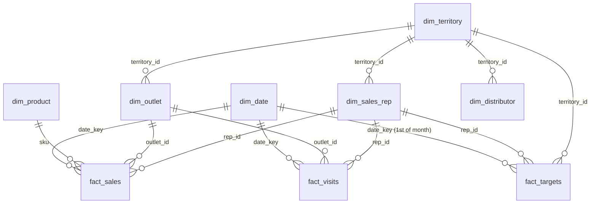

# Data model

A classic star schema: three fact tables at different grains sharing conformed dimensions.

| Table | Grain | Rows |
|---|---|---:|
| `fact_sales` | one invoice line (outlet × SKU × visit) | ~279K |
| `fact_visits` | one planned outlet visit by a sales officer | ~122K |
| `fact_targets` | one sales officer × month | 768 |
| `dim_date` | one day, 2024–2025 | 731 |
| `dim_product` | SKU (10) with category, brand, pack, price | 10 |
| `dim_outlet` | retail outlet with type and grade (A/B/C) | 1,164 |
| `dim_sales_rep` | sales officer | 32 |
| `dim_territory` | territory → region → division | 22 |
| `dim_distributor` | one distribution house per territory | 22 |

## Relationships (all single-direction, one-to-many)

| From (many) | To (one) | Notes |
|---|---|---|
| `fact_sales[date_key]` | `dim_date[date_key]` | |
| `fact_visits[date_key]` | `dim_date[date_key]` | |
| `fact_targets[date_key]` | `dim_date[date_key]` | Targets are monthly and keyed to the 1st of the month, so slice targets by month or above, not by day |
| `fact_sales[sku]` | `dim_product[sku]` | |
| `fact_sales[outlet_id]`, `fact_visits[outlet_id]` | `dim_outlet[outlet_id]` | |
| `fact_sales[rep_id]`, `fact_visits[rep_id]`, `fact_targets[rep_id]` | `dim_sales_rep[rep_id]` | |
| `dim_outlet[territory_id]` | `dim_territory[territory_id]` | Snowflaked: territory filters outlets, which filter facts |
| `dim_sales_rep[territory_id]` | `dim_territory[territory_id]` | **Set inactive.** Power BI allows only one active path from territory to the facts; use `USERELATIONSHIP` if you need territory via rep |
| `dim_distributor[territory_id]` | `dim_territory[territory_id]` | |
| `fact_targets[territory_id]` | `dim_territory[territory_id]` | Lets division/territory slicers filter targets directly, since the rep → territory path is inactive |

## Modelling choices

- **Mark `dim_date` as the date table** (on `date`) so `SAMEPERIODLASTYEAR`, `TOTALMTD` and `TOTALYTD` work.
- **Hide every key column and fact column** in report view; expose measures only. Users then can't drag a raw sum of `net_bdt` that ignores returns.
- **Sort `dim_date[month]` by `month_no`** so months don't sort alphabetically.
- **Hierarchy:** Division → Region → Territory on `dim_territory`, for drill-down on maps and matrices.
